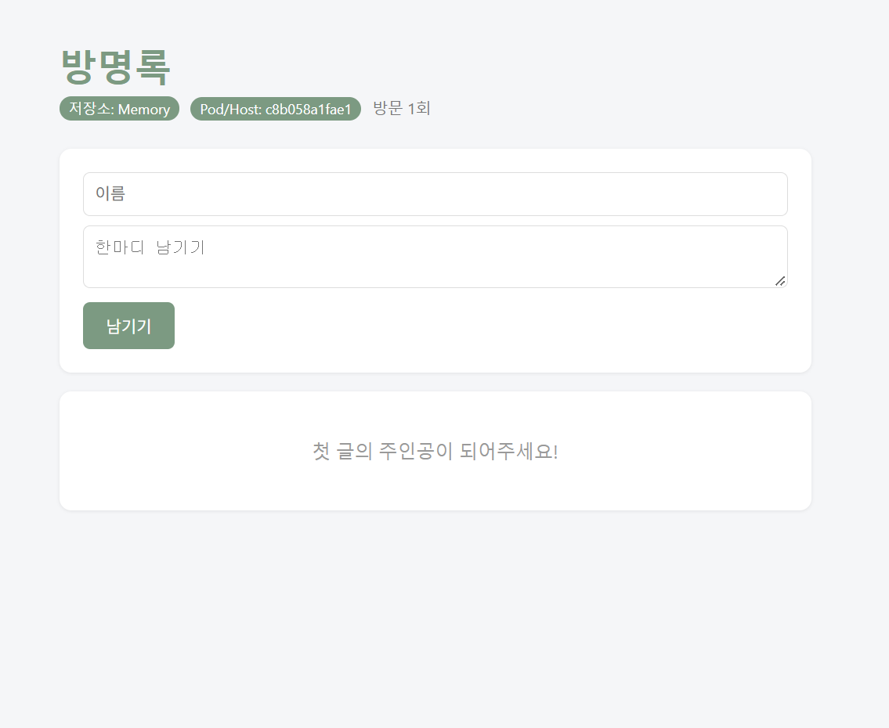
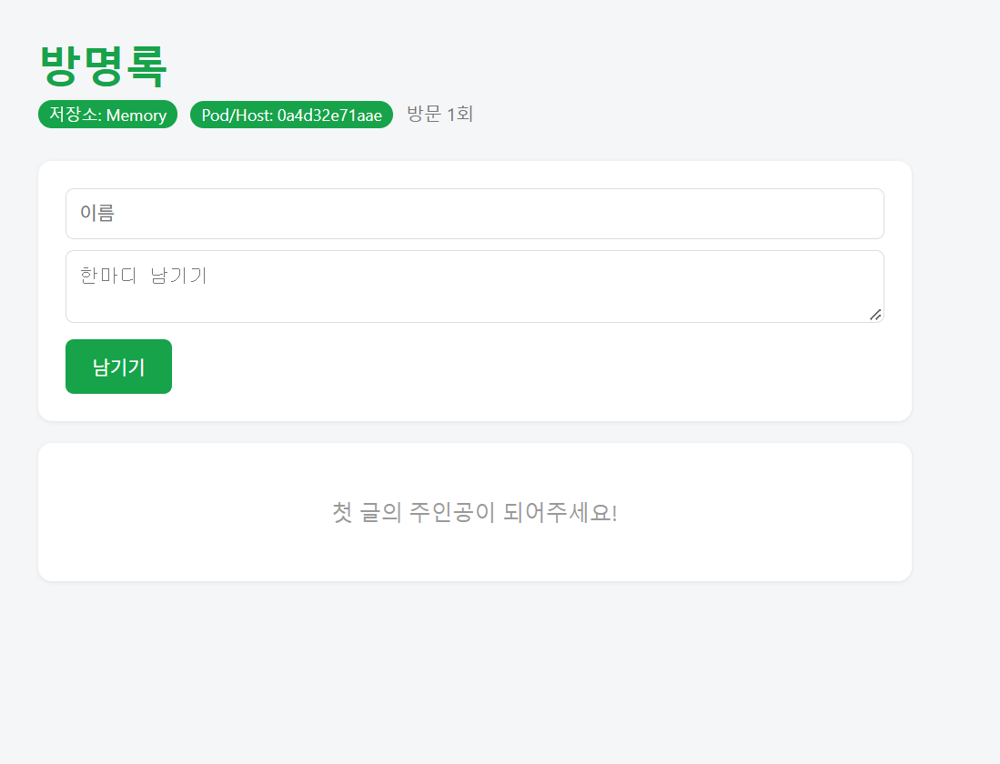

# 6주차 - Dockerfile 실습

## 1. 실습 목표
- Dockerfile의 기본 명령어 이해하기
- Dockerfile을 이용해 이미지 직접 생성하기
- 직접 만든 이미지로 컨테이너 실행하기
- 컨테이너 로그와 종료 상태 확인하기

## 2. 실습 환경
- Windows WSL2 Ubuntu
- Docker Desktop
- Docker 29.8.1
- Python 3.12-slim 이미지

## 3. 실습 과정

> 아래 내용은 기존 실습 기록이다. 당시 작성한 week06/Dockerfile과
> week06/app.py는 프로젝트 구조 정리 과정에서 제거되었으며,
> 기존 파일은 Git 이력에서 확인할 수 있다.

### 3-1. Dockerfile 작성

`week06/Dockerfile` 파일을 작성했다.

```dockerfile
FROM python:3.12-slim

WORKDIR /app

COPY app.py .

CMD ["python", "app.py"]
```

- `FROM`: 기본 이미지 지정
- `WORKDIR`: 컨테이너 내부 작업 폴더 지정
- `COPY`: 프로그램 파일 복사
- `CMD`: 컨테이너 실행 시 수행할 명령어 지정

### 3-2. Python 프로그램 작성

`week06/app.py` 파일을 작성했다.

```python
print("Dockerfile 실습 성공!")
print("6주차 Docker 이미지 실행 완료")
```

### 3-3. Docker 이미지 빌드

```bash
docker build -t week06-python:1.0 ./week06
docker images week06-python
```

**실행 결과**

Docker 이미지 빌드가 정상적으로 완료됐으며, `week06-python:1.0` 이미지가 생성된 것을 확인했다.

### 3-4. 컨테이너 실행

```bash
docker run --name week06-test week06-python:1.0
```

**실행 결과**

```text
Dockerfile 실습 성공!
6주차 Docker 이미지 실행 완료
```

직접 만든 이미지로 Python 프로그램을 정상 실행했다.

### 3-5. 컨테이너 상태 확인

```bash
docker ps -a --filter "name=week06-test"
```

컨테이너가 `Exited (0)` 상태인 것을 확인했다.

### 3-6. 로그 및 종료 코드 확인

```bash
docker logs week06-test
docker inspect -f '{{.State.Status}} / 종료 코드: {{.State.ExitCode}}' week06-test
```

**실행 결과**

```text
Dockerfile 실습 성공!
6주차 Docker 이미지 실행 완료
exited / 종료 코드: 0
```

컨테이너가 정상적으로 실행되고 종료된 것을 확인.

## 4. 실습하면서 알게 된 점

- Dockerfile을 작성하면 필요한 실행 환경을 이미지로 만들 수 있음.
- `docker build`는 Dockerfile을 바탕으로 이미지를 생성.
- `docker run`은 생성된 이미지로 컨테이너를 실행.
- `docker logs`를 이용하면 종료된 컨테이너의 출력도 확인할 수 있음.
- 종료 코드가 `0`이면 프로그램이 정상적으로 종료됐다는 뜻.

## 5. 실습 결과

Dockerfile과 Python 프로그램을 직접 작성한 뒤 Docker 이미지를 빌드. 
생성한 이미지로 컨테이너를 실행했고, 로그와 종료 코드를 통해 정상적으로 작동한 것을 확인.
## 혼자 해보기

### 1. 나만의 방명록 V2 배포

- 제목: 나만의 DevOps 방명록
- 테마 색상: #7C9A82
- 입력 문구: 오늘의 이야기를 남겨주세요

이미지 빌드 및 업로드에 성공하였다.

- 내 이미지 주소: `ghcr.io/youmji/guestbook:v2`

컨테이너 실행 시 `-e THEME_COLOR="#C6A15B"`를 사용하여
Dockerfile에 설정한 색상 대신 금색이 적용되는 것을 확인하였다.

### 2. 친구 이미지 위에 내 설정 굽기

친구 이미지 주소: `ghcr.io/dino1121/guestbook:v1`

Dockerfile.custom을 작성하였다.

```dockerfile
FROM ghcr.io/dino1121/guestbook:v1
ENV APP_TITLE="방명록" \
    THEME_COLOR="#7C9A82"
```

친구의 기존 이미지에 제목과 테마 색상을 설정한 후
8082번 포트에서 정상적으로 실행되는 것을 확인하였다.



docker history guestbook:custom 명령어를 통해
기존 이미지 위에 새로운 ENV 설정이 추가된 것을 확인하였다.

### 3. 환경 변수 우선순위 확인

기존 custom 컨테이너를 제거하고 다음 명령어로 실행하였다.

```bash
docker run -d -p 8083:5000 --name custom -e THEME_COLOR="#16a34a" guestbook:custom
```



Dockerfile.custom에서 설정한 #7C9A82보다
실행 시 -e로 전달한 #16a34a가 우선 적용되었다.

### 4. Dockerfile 각 명령어 설명

| 명령어 | 설명 |
|---|---|
| FROM | Python 3.12 경량 이미지를 기본 이미지로 사용한다. |
| WORKDIR | 컨테이너 내부의 작업 디렉터리를 설정한다. |
| COPY requirements.txt . | 라이브러리 목록 파일을 복사한다. |
| RUN pip install | 프로그램 실행에 필요한 라이브러리를 설치한다. |
| COPY . . | 빌드에 포함되는 프로젝트 파일을 복사한다. |
| RUN useradd -m appuser | 홈 디렉터리를 포함한 일반 사용자를 생성한다. |
| USER appuser | root 대신 일반 사용자 권한으로 실행한다. |
| ENV | 제목과 테마 색상을 환경 변수로 설정한다. |
| EXPOSE 5000 | 컨테이너에서 사용하는 포트를 명시한다. |
| CMD | 컨테이너 시작 시 app.py를 실행한다. |

### 5. 빌드 캐시 확인

동일한 Dockerfile로 두 번 빌드하였다.

- 첫 번째 빌드: 10.0초
- 두 번째 빌드: 0.6초

실제 빌드 캐시 로그:

```text
CACHED [2/6] WORKDIR /app
CACHED [3/6] COPY requirements.txt .
CACHED [4/6] RUN pip install --no-cache-dir -r requirements.txt
CACHED [5/6] COPY . .
CACHED [6/6] RUN useradd -m appuser
```

기존 빌드 결과를 재사용하여 빌드 시간이 줄어드는 것을 확인하였다.

### 6. 설정을 넣는 세 가지 방법

| 방법 | 설정 시점 | 변경 방법 |
|---|---|---|
| app.py 기본값 수정 | 코드 작성 시점 | 코드 수정 후 이미지 재빌드 |
| Dockerfile ENV | 이미지 빌드 시점 | 이미지 재빌드 |
| docker run -e | 컨테이너 실행 시점 | 컨테이너 재생성 및 실행 |

환경 변수 적용 우선순위는 docker run -e, Dockerfile ENV,
app.py 기본값 순서이다.

※ 2026년 11월 26일 기존 프로젝트를 기반으로 6주차 미완료 실습을 보완하였다.
