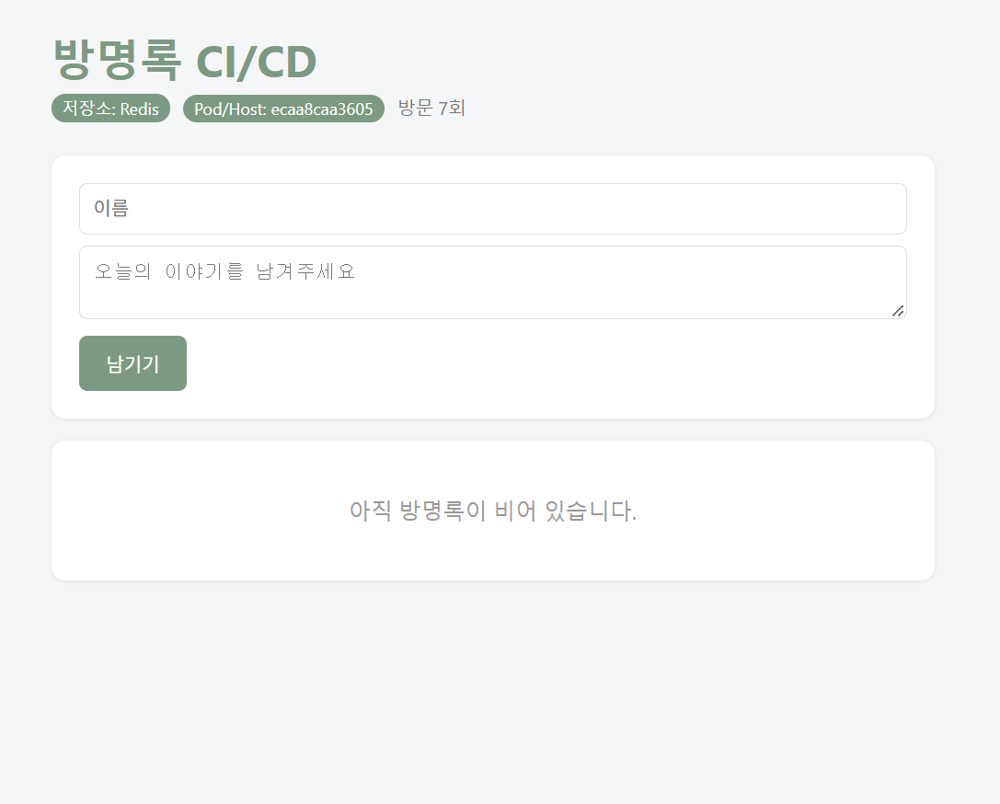
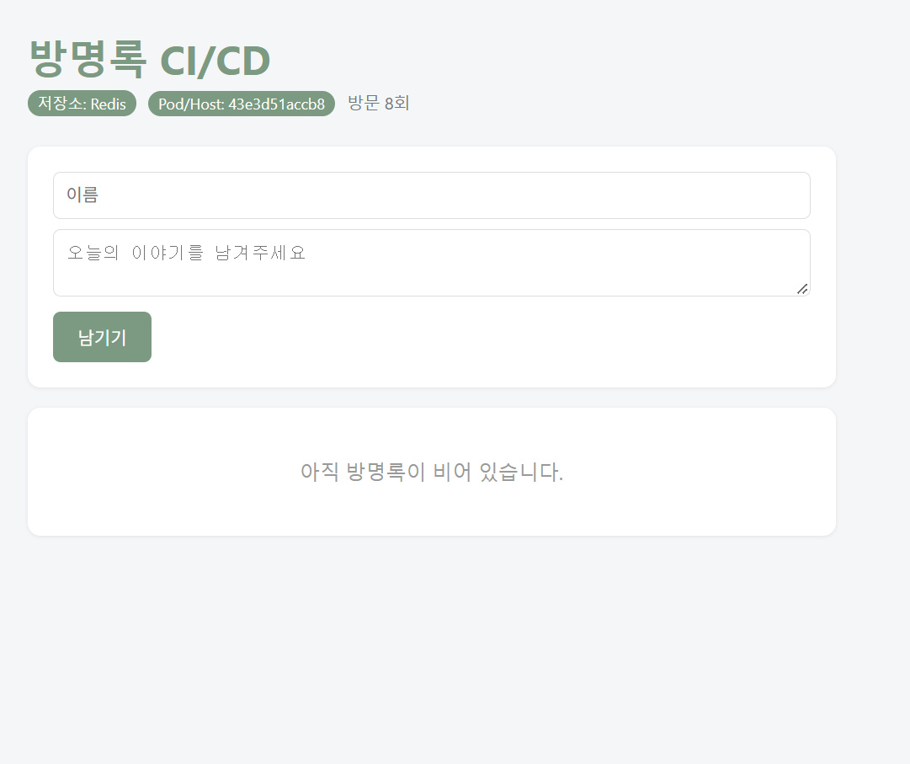
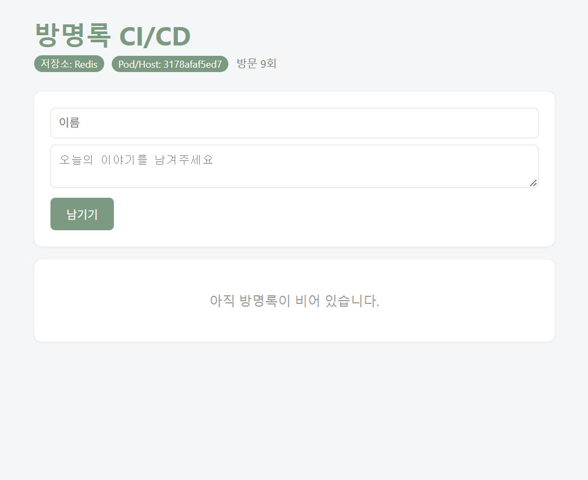

# 7주차 - Docker Compose 실습

## 1. 실습 목표

- Docker Compose 설정 파일 작성하기
- Nginx 웹 서버 실행하기
- web 서비스의 컨테이너를 3개로 확장하기
- 컨테이너 중지 및 복구 과정 확인하기

## 2. 실습 환경

- Windows WSL2 Ubuntu
- Docker Desktop
- Docker Compose
- nginx:alpine 이미지

## 3. 실습 과정

### 3-1. Docker Compose 파일 작성

`week07/compose.yaml` 파일을 작성.

```yaml
services:
  web:
    image: nginx:alpine
    ports:
      - "80"
```

Nginx 웹 서버를 실행하도록 설정. 호스트 포트는 자동으로 할당되도록 함.

### 3-2. Docker Compose 실행

```bash
docker compose -f week07/compose.yaml -p week07 up -d
docker compose -f week07/compose.yaml -p week07 ps
```

**실행 결과**

`week07-web-1` 컨테이너가 정상적으로 실행됨.

### 3-3. web 컨테이너 3개로 확장

```bash
docker compose -f week07/compose.yaml -p week07 up -d --scale web=3
```

**실행 결과**

- week07-web-1: Up
- week07-web-2: Up
- week07-web-3: Up

web 서비스의 컨테이너가 3개 실행되는 것을 확인.

### 3-4. 컨테이너 하나 중지

```bash
docker stop week07-web-2
docker compose -f week07/compose.yaml -p week07 ps
```

**실행 결과**

web-2가 중지되면서 실행 중인 컨테이너가 2개로 줄었다.

### 3-5. 컨테이너 수 복구

```bash
docker compose -f week07/compose.yaml -p week07 up -d --scale web=3
docker compose -f week07/compose.yaml -p week07 ps
```

**실행 결과**

중지됐던 web-2가 다시 실행됐으며, 세 컨테이너 모두 Up 상태로 복구됨.

## 4. 실습하면서 알게 된 점

- Docker Compose를 사용하면 여러 컨테이너를 하나의 설정 파일로 관리할 수 있음.
- `--scale web=3`으로 web 서비스의 컨테이너 수를 3개로 맞출 수 있음.
- 컨테이너 하나를 중지했을 때 자동으로 즉시 복구되지는 않음.
- `docker compose up -d --scale web=3`을 다시 실행해 컨테이너 수를 복구할 수 있음.
- 호스트 포트를 자동 할당하면 컨테이너 재실행 시 포트 번호가 달라질 수 있음.

## 5. web 컨테이너 3개 유지 방법과 한계

이번 실습에서는 `--scale web=3` 명령어를 이용해 컨테이너 3개를 실행하고, 중지된 컨테이너를 수동으로 복구.

**장점**
- 명령어 하나로 컨테이너 수를 조절할 수 있음.
- 설정 파일이 간단.
- 여러 컨테이너를 한꺼번에 관리할 수 있음.

**단점 및 한계**
- 이번 설정만으로는 컨테이너가 중지됐을 때 항상 3개가 자동 유지되지는 않음.
- 장애를 감지하고 복구 명령어를 실행하는 별도의 관리 방식이 필요할 수 있음.
- 단일 Docker 호스트 자체에 장애가 발생하면 모든 컨테이너가 영향을 받을 수 있음.

## 6. 실습 결과

Docker Compose로 Nginx 웹 서버를 실행한 뒤 web 컨테이너를 3개로 확장. 
컨테이너 하나를 중지하고 다시 복구하는 과정을 통해 컨테이너 수를 관리하는 방법과 한계를 이해함.


## Docker Compose 자동 감시 및 복구 실습

### 실습 목적
Docker Compose로 실행한 web 컨테이너 3개 중 하나가 중지되었을 때, 실행 중인 컨테이너 수를 확인하고 부족한 컨테이너를 자동으로 복구.

### 실습 방법
1. `auto-recover.sh` 스크립트를 작성.
2. 스크립트가 10초마다 실행 중인 컨테이너 수를 확인하도록 함.
3. `bash week07/auto-recover.sh` 명령어로 감시를 시작.
4. 다른 터미널에서 `docker stop week07-web-2` 명령어로 컨테이너 하나를 중지.
5. 컨테이너 수가 2개로 감소하면 `docker compose -f week07/compose.yaml -p week07 up -d --scale web=3` 명령어로 복구.

### 실행 결과
- 최초 실행 중인 web 컨테이너: 3개
- `week07-web-2` 중지 후: 2개
- 자동 복구 명령어 실행 후: 3개
- 중지된 컨테이너가 다시 시작되는 것을 확인.

### 장점
- 컨테이너 수가 부족할 때 자동으로 복구할 수 있음.
- 반복적으로 상태를 확인하므로 사람이 직접 명령어를 입력하는 횟수를 줄일 수 있음.
- Bash와 Docker Compose 명령어만으로 구현할 수 있음.

### 단점 및 한계
- 스크립트가 종료되면 자동 감시도 중단됨.
- 10초 간격으로 검사하므로 장애를 즉시 발견하지 못할 수 있음.
- 실행 중인 컨테이너 개수만 확인하므로 웹 서비스가 실제로 정상 응답하는지는 보장할 수 없음.
- Docker 엔진 자체가 중단되면 이 스크립트만으로 복구할 수 없음.
- 여러 서버에 분산된 컨테이너를 관리하는 용도로는 한계가 있음.

## 혼자 해보기

### 1. Docker Compose 실행 및 Healthcheck 확인

```bash
docker compose up -d
docker compose ps
```

실행 결과:

| 컨테이너 | 상태 | 포트 |
|---|---|---|
| guestbook-nginx-1 | Up | 8080:80 |
| guestbook-redis-1 | Up (healthy) | 6379 |
| guestbook-web-1 | Up (healthy) | 5000 |
| guestbook-web-2 | Up (healthy) | 5000 |
| guestbook-web-3 | Up (healthy) | 5000 |

Redis 연결에 성공하였으며, /readyz 요청에 HTTP 200 응답이 반환되는 것을 확인하였다.

### 2. web 컨테이너 확장 및 호스트명 확인

```bash
docker compose up -d --scale web=3
docker compose ps
docker ps --format "{{.ID}} {{.Names}}"
```

브라우저에서 localhost:8080에 접속한 후 새로고침하여 서로 다른 web 컨테이너가 응답하는 것을 확인하였다.

| 컨테이너 | 컨테이너 ID | 방문 횟수 |
|---|---|---|
| guestbook-web-3 | ecaa8caa3605 | 7회 |
| guestbook-web-2 | 43e3d51accb8 | 8회 |
| guestbook-web-1 | 3178afaf5ed7 | 9회 |







새로고침 시 서로 다른 web 컨테이너가 응답하였으며, 하나의 Redis를 공유하므로 방문 횟수가 연속적으로 증가하였다.

### 3. down 후 up과 down -v 후 up 차이 비교

#### down 후 up

```bash
docker compose down
docker compose up -d
```

컨테이너가 재생성되어 호스트명이 변경되었지만 기존 방명록 글 2개가 그대로 유지되었다.

#### down -v 후 up

```bash
docker compose down -v
docker compose up -d
```

기존 방명록 글 2개가 모두 사라졌으며 방문 횟수가 1회로 초기화되었다.

| 비교 항목 | down 후 up | down -v 후 up |
|---|---|---|
| 컨테이너 재생성 | O | O |
| 기존 볼륨 삭제 | X | O |
| 기존 데이터 유지 | O | X |
| 방명록 글 | 2개 유지 | 0개 |

down은 컨테이너와 네트워크를 삭제하지만 기존 데이터 볼륨은 유지한다. down -v는 데이터 볼륨까지 삭제하므로 기존 데이터가 사라진다.

### 4. .env를 Git에 올리지 않는 이유

.env 파일에는 Redis 비밀번호와 같은 민감한 정보가 포함되어 있다. GitHub에 업로드하면 다른 사람에게 비밀번호가 노출될 수 있으므로 .gitignore에 .env를 추가하여 Git 추적 대상에서 제외하였다.

실제 비밀번호 대신 환경 변수의 작성 형식을 알려주는 .env.example 파일만 Git에 포함한다.

※ 2026년 11월 26일 기존 프로젝트를 기반으로 7주차 미완료 실습을 보완하였다.
