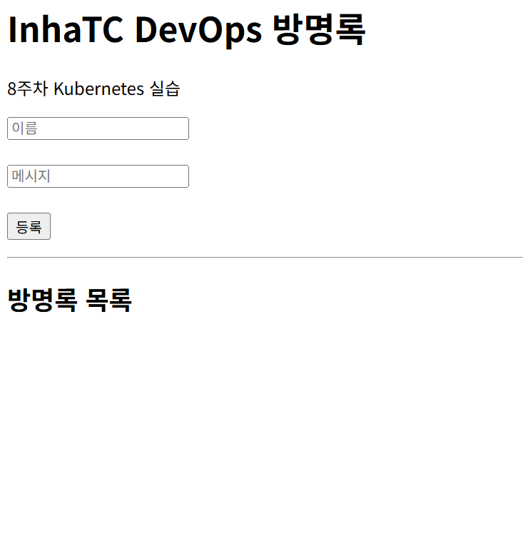
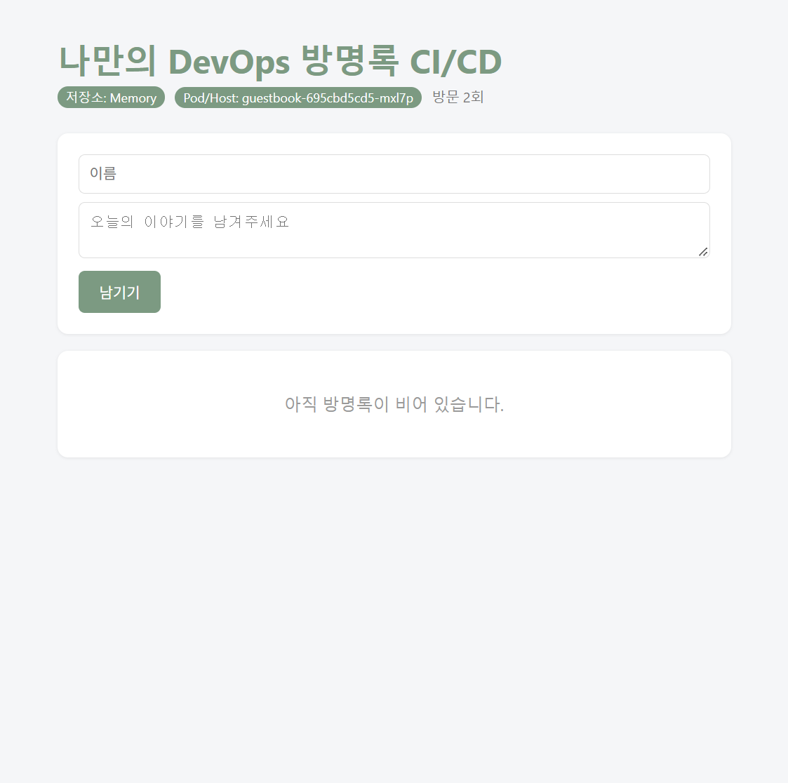

# 9주차 DevOps 실습 - Kubernetes

## 1. 실습 목적

이번 실습에서는 Minikube와 kubectl을 이용해 Kubernetes의 기본 동작을 확인하였다.

Pod와 Deployment의 차이를 이해하고, Pod 삭제 시 자동 복구되는 자가 치유(Self-healing) 기능과 Replica 수 조절 기능을 실습하였다.

추가로 Python Flask로 방명록 웹 애플리케이션을 제작하고, Docker 이미지로 빌드한 후 GitHub Container Registry(GHCR)에 업로드하여 Kubernetes 환경에 배포하였다.

## 2. 실습 환경

- OS: Ubuntu (WSL2)
- 컨테이너 환경: Docker Desktop
- Kubernetes: Minikube
- Kubernetes 버전: v1.37.0
- 이미지 저장소: GitHub Container Registry (GHCR)
- 웹 애플리케이션: Python Flask

## 3. Pod 생성 및 확인

```bash
kubectl run mynginx --image=nginx
kubectl get pods
kubectl describe pod mynginx
kubectl logs mynginx
```

단독으로 생성한 Pod는 삭제해도 자동으로 다시 생성되지 않는 것을 확인하였다.

## 4. Deployment 생성 및 자가 치유

```bash
kubectl create deployment mynginx --image=nginx --replicas=3
kubectl get pods
kubectl get deployments
kubectl get rs
```

Deployment로 Pod 3개를 실행한 후 Pod 하나를 삭제하였다.

Deployment가 새로운 Pod를 자동 생성하여 Replica 수를 유지하는 것을 확인하였다.

## 5. Replica 수 변경

```bash
kubectl scale deployment mynginx --replicas=5
kubectl get pods

kubectl scale deployment mynginx --replicas=2
kubectl get pods
```

Replica 수를 3개에서 5개로 늘린 뒤 다시 2개로 줄였다.

Kubernetes가 설정한 Replica 수에 맞춰 Pod 개수를 자동으로 조절하는 것을 확인하였다.

## 6. Flask 방명록 Docker 이미지 생성

Python Flask를 이용해 간단한 방명록 웹 애플리케이션을 제작하였다.

방명록은 이름과 메시지를 입력받아 메모리에 저장하고, 등록된 메시지를 화면에 출력하도록 구현하였다.

```bash
docker build -t guestbook:v1 .
docker run -d --name week09-guestbook -p 5000:5000 guestbook:v1
docker ps
```

브라우저에서 `http://localhost:5000`에 접속하여 웹사이트 실행을 확인하였다.

## 7. GHCR 이미지 업로드

```bash
docker tag guestbook:v1 ghcr.io/youmji/guestbook:v1
docker push ghcr.io/youmji/guestbook:v1
```

Docker 이미지를 GitHub Container Registry에 업로드하였다.

이미지 주소:

`ghcr.io/youmji/guestbook:v1`

## 8. Kubernetes 방명록 배포

```bash
kubectl create deployment guestbook --image=ghcr.io/youmji/guestbook:v1
kubectl get pods
kubectl port-forward deployment/guestbook 8080:5000
```

브라우저에서 `http://localhost:8080`에 접속하여 Kubernetes Pod에서 실행 중인 방명록 웹사이트를 확인하였다.

## 9. Pod 삭제 및 자동 복구 실험

```bash
kubectl delete pod -l app=guestbook
kubectl get pods
```

기존 Pod를 삭제한 뒤 새로운 Pod가 자동 생성되는 것을 확인하였다.

- 삭제된 Pod: `guestbook-79dc786577-zk24r`
- 새로 생성된 Pod: `guestbook-79dc786577-pvrnx`
- 새 Pod 상태: `Running`

이를 통해 Deployment의 자가 치유 기능을 확인하였다.

## 10. 메모리 데이터 초기화 확인

방명록에 메시지를 등록한 뒤 Pod를 삭제하고 다시 접속하였다.

새 Pod에서 웹사이트는 정상적으로 실행되었지만 이전에 등록했던 메시지는 사라졌다.

방명록 데이터를 Python 프로그램의 메모리에 저장했기 때문에, Pod가 재생성되면서 메모리 데이터도 초기화된 것이다.

이를 통해 Kubernetes의 자가 치유 기능은 애플리케이션의 실행 상태를 복구하지만 메모리 데이터를 영구적으로 보존하지는 않는다는 점을 확인하였다.

## 11. 실습 결과 및 느낀 점

이번 실습을 통해 Docker 컨테이너를 직접 실행하는 방식과 Kubernetes Deployment를 이용해 애플리케이션을 관리하는 방식의 차이를 이해할 수 있었다.

특히 Pod를 직접 삭제했는데도 새로운 Pod가 자동으로 생성되는 과정을 확인하면서 Kubernetes의 자가 치유 기능을 이해할 수 있었다.

또한 Replica 수를 변경하여 Pod 개수를 조절하고, GHCR에 업로드한 이미지를 Kubernetes에서 실행하는 과정까지 경험하였다.

마지막으로 Pod가 복구되더라도 메모리에 저장된 데이터는 유지되지 않는다는 점을 확인하였으며, 실제 서비스에서는 데이터베이스나 영구 저장소를 활용해야 한다는 것을 알게 되었다.

## 혼자 해보기

### 1. Kubernetes 노드 상태 확인

사용한 도구: Minikube

실행 결과:

```text
NAME       STATUS   ROLES           AGE   VERSION
devops09   Ready    control-plane   14d   v1.37.0
```

노드가 Ready 상태인 것을 확인하였다.

### 2. Pod 삭제 및 자가 치유 확인

kubectl get pods -w 명령어로 Pod의 상태 변화를 확인하였다.

- 삭제된 Pod: guestbook-9f47d76f8-485sj
- 새로 생성된 Pod: guestbook-9f47d76f8-v5bkj

새로운 Pod의 상태 변화:

```text
Pending
ContainerCreating
Running
```

Pod를 삭제해도 Deployment가 새로운 Pod를 생성하여
설정된 Pod 개수를 유지하는 것을 확인하였다.

### 3. Kubernetes 방명록 실행 화면





Kubernetes에서 방명록 웹사이트가 정상적으로 실행되는 것을 확인하였다.

- 저장소: Memory
- Pod/Host: guestbook-695cbd5cd5-mxl7p
- 실행 이미지: ghcr.io/youmji/guestbook:v2

브라우저에서 현재 방명록을 실행하고 있는 Pod의 이름을 확인하였다.

### 4. 선언형이란?

원하는 최종 상태를 지정하면 Kubernetes가 현재 상태를
확인하고 원하는 상태가 되도록 자동으로 관리하는 방식이다.

### 5. 막혔던 부분과 해결 방법

**문제 1. Minikube 프로필 중지**

기존 devops09 Minikube 프로필이 중지되어 있었다.

devops09 프로필을 다시 시작하고 해당 컨텍스트에서 노드와 Pod의 상태를 확인하여 실습을 진행하였다.

**문제 2. Pod/Host가 표시되지 않는 문제**

기존 v1 이미지에는 Pod/Host 표시 기능이 없어 v2 이미지로 변경하였다.

그러나 imagePullPolicy가 IfNotPresent로 설정되어 있어 이전 v2 이미지가 재사용되었다.

imagePullPolicy를 Always로 변경한 후 새로운 이미지가 적용되었으며, Pod 5개가 정상적으로 실행되는 것을 확인하였다.

이후 포트 포워딩을 다시 실행하여 브라우저에서 Pod/Host가 정상적으로 표시되는 것을 확인하였다.

이를 통해 동일한 이미지 태그를 사용하더라도 이미지 다운로드 정책에 따라 이전 이미지가 실행될 수 있다는 점을 이해하였다.

※ 2026년 11월 26일 기존 프로젝트를 기반으로 9주차 실습 기록을 보완하였다. Pod/Host 실행 화면은 이후 제작한 v2 이미지를 활용하여 보완하였다.
